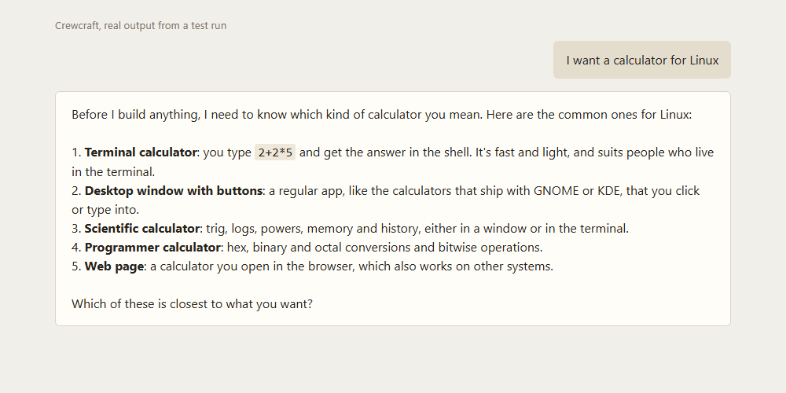
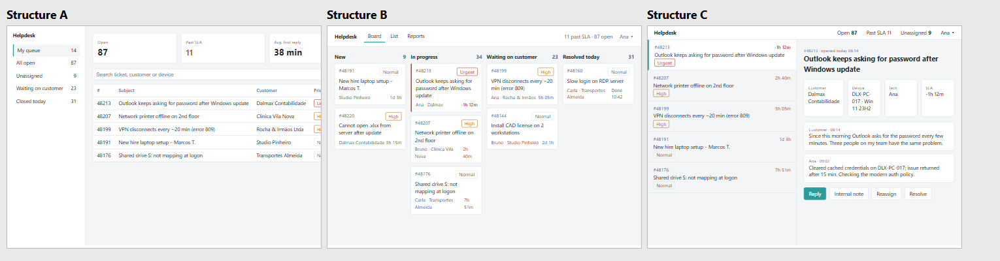
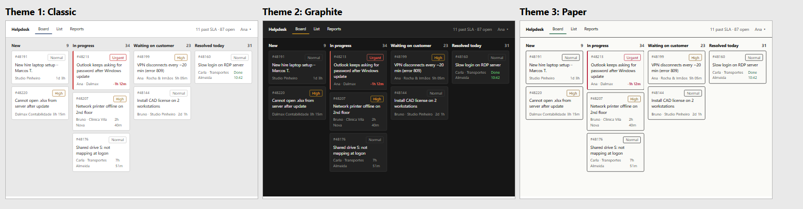
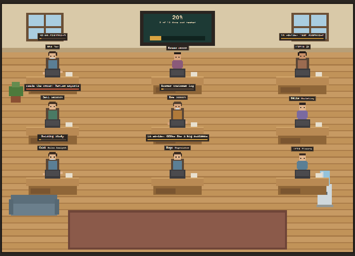
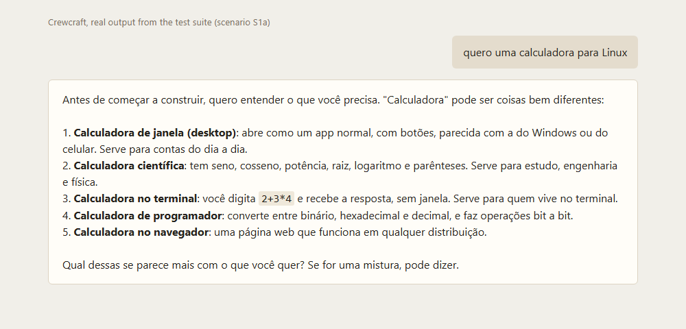
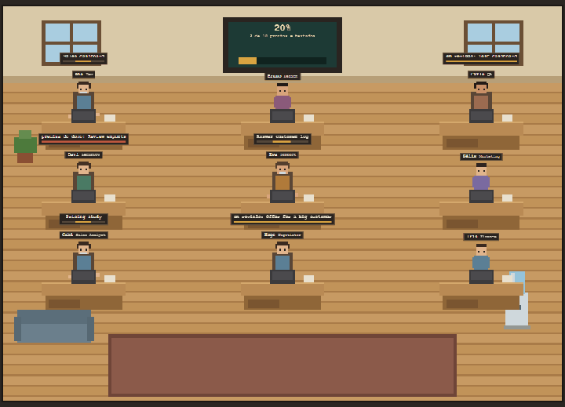

# Crewcraft

[English](#english) · [Português](#português)

---

## English

Crewcraft turns Claude Code into a small software company. It asks before it builds, researches the market, shows you the look before it codes, and runs a crew of specialists with a release gate. It talks to you at your own level, from complete beginner to AI engineer.

> v1.0.0 · MIT license

### How a project flows

1. **Start with a command**: `/crewcraft:comecar`.
2. **Tell it your idea**, from a calculator to a sales company.
3. **Research** (`pesquisa`): it defines the concept, then finds competitors, official and current documentation, and useful tools, skills, plugins and MCP servers, and proposes the crew. You approve every item.
4. **Shaping** (`conversa`, `prototipo-visual`): questions about what must run, how many users and how exposed it is, and the look. It installs nothing the project does not need.
5. **Phases** (`gerente`): the manager runs the crew phase by phase. You choose whether it stops after certain phases or only when all are done. Each phase has its own document with its architecture and what each role executes.
6. **Delivery**: everything built, tested and signed by QA, Security, the test supervisor and the manager. Only then it tells you "you can commit".



### What it recommends

For each project, the research recommends **plugins, skills and MCP servers to install for that project**, each with a verdict (use, improve or avoid), the reason, the source, the date and the license. Crewcraft ships none of them. What you approve is downloaded and set up for that project only, after it tells you the file name, the source and the size. Anything found online is read and analysed first, never run blindly (NVIDIA's open-source SkillSpector is a good extra check). For projects with a lot of documentation it also recommends a local search over those documents (RAG), and says plainly when it is not needed.

### A crew as big as the project

Eleven agents come ready: `researcher`, `dev`, `design`, `qa`, `security`, `support`, `marketing`, and the supervisors `supervisor-dev`, `supervisor-design`, `supervisor-teste` and `supervisor-geral`. Supervisors cannot edit anything: they re-run the checks themselves and approve or reject.

A project is never limited to them. A sales company can add a sales analyst, a negotiator and a finance reviewer, as many roles as it needs, with `cargos.py add`. Each new role gets its own agent, its place in the queue, a supervisor and a desk in the office. Project skills have no limit either: after the research, `skills-do-projeto` writes as many small skills as the project needs, inside the project.

### Robust testing, proportional to the risk

The crew asks how many people will use the project, how exposed it is (local, internal network or public IP), what data it handles, how strong the security must be and how many users to stress-test with. From the answers it derives the checks that must pass before a release: a small offline calculator gets two (input and functional variations); a public system that handles money gets nineteen (injection tests on every input, authentication and permissions, abuse and denial-of-service resistance, load and stress tests at your number of users and at double it, soak and recovery tests, money calculations, an audit trail). Every check is recorded with evidence, and the release stays closed until all of them passed or you waived them. Load, stress and attack-style tests run only against the project's own environment.

### The look comes first

Three layouts that differ in structure, with no colors in them, then the same layout under three different themes. Say "it looks like AI made it" and it changes direction, asks for a reference, and remembers what you disliked.





### The office

An optional pixel office: each role at its desk, the task above the head of whoever works, and idle roles walking around, drinking water and chatting. It only reads the project's queue and runs on your computer. Open it with `/crewcraft:escritorio`.



### What is inside

| Skill or command | What it does |
|---|---|
| `conversa` | Asks before building, adapts to your level, records every decision. |
| `pesquisa` | Researches competitors, tools and documentation with sources and dates. |
| `prototipo-visual` | Shows the look in two rounds and blocks building until you approve. |
| `gerente` | Plans, orders the queue, dispatches the crew, guards the release. |
| `ficha-do-projeto` | Keeps decisions, questions and the visual profile inside the project, with client variants. |
| `skills-do-projeto` | Writes the project's own skills and a managed block in its `CLAUDE.md`. |
| `enxuto` | The lean rule: the least that fully does the job, and a dependency audit. |
| `ambiente` | Finds what your computer has and suggests tools by job, each with its weakness. |
| `/crewcraft:comecar` | Starts the conversation: `/crewcraft:comecar I want a dashboard for my team`. |
| `/crewcraft:atualizar` | Refreshes the research so the project does not fall behind the market. |
| `/crewcraft:escritorio` | Opens the optional pixel office. |

Claude usually starts the conversation by itself when you ask for something to be built, but that is not guaranteed. `/crewcraft:comecar` always starts it.

### It adapts to you

Your level is kept per area (development, design, security, infrastructure, AI) as beginner, intermediate or expert. A beginner gets plain words and analogies; an expert gets short answers and real trade-offs. Say "speak simpler" or "you can be technical" at any time.

### Install

```
/plugin marketplace add fsorato/crewcraft
/plugin install crewcraft@crewcraft
```

The helper scripts and the release gate use Python 3. Everything about a project lives in its own `.crewcraft/` folder.

### License

MIT. See the `LICENSE` file.

---

## Português

O Crewcraft transforma o Claude Code numa pequena empresa de software. Ele pergunta antes de construir, pesquisa o mercado, mostra o visual antes de programar e coordena uma equipe de especialistas com um portão de liberação. Ele conversa no seu nível, de iniciante a engenheiro de IA.

> v1.0.0 · licença MIT

### Como um projeto anda

1. **Comece com um comando**: `/crewcraft:comecar`.
2. **Conte a sua ideia**, de uma calculadora a uma empresa de vendas.
3. **Pesquisa** (`pesquisa`): define o conceito, depois busca concorrentes, documentação oficial e atual, e ferramentas, skills, plugins e servidores MCP úteis, e propõe a equipe. Você aprova cada item.
4. **Montagem** (`conversa`, `prototipo-visual`): perguntas sobre o que precisa rodar, quantos usuários e o quanto fica exposto, e o visual. Não instala nada que o projeto não precise.
5. **Fases** (`gerente`): o gerente conduz a equipe fase a fase. Você escolhe se ele para depois de certas fases ou só quando todas estiverem prontas. Cada fase tem documento próprio com a sua arquitetura e o que cada cargo executa.
6. **Entrega**: tudo feito, testado e assinado por QA, Segurança, supervisor de teste e gerente. Só então ele diz "pode commitar".



### O que ele recomenda

Para cada projeto, a pesquisa recomenda **plugins, skills e servidores MCP para instalar naquele projeto**, cada um com um veredito (usar, melhorar ou evitar), o motivo, a fonte, a data e a licença. O Crewcraft não traz nenhum deles. O que você aprovar é baixado e configurado só para aquele projeto, depois de ele dizer o nome do arquivo, a origem e o tamanho. Tudo que vem da internet é lido e analisado antes, nunca executado às cegas (o SkillSpector, de código aberto da NVIDIA, é uma boa checagem extra). Para projetos com muita documentação, ele também recomenda uma busca local nesses documentos (RAG), e diz com clareza quando ela não é necessária.

### Uma equipe do tamanho do projeto

Onze agentes vêm prontos: `researcher`, `dev`, `design`, `qa`, `security`, `support`, `marketing`, e os supervisores `supervisor-dev`, `supervisor-design`, `supervisor-teste` e `supervisor-geral`. Os supervisores não podem editar nada: eles refazem as conferências e aprovam ou reprovam.

Um projeto nunca fica limitado a eles. Uma empresa de vendas pode adicionar um analista de vendas, um negociador e um revisor financeiro, quantos cargos precisar, com `cargos.py add`. Cada cargo novo ganha seu próprio agente, seu lugar na fila, um supervisor e uma mesa no escritório. As skills do projeto também não têm limite: depois da pesquisa, `skills-do-projeto` escreve quantas skills pequenas o projeto precisar, dentro do projeto.

### Testes de robustez, proporcionais ao risco

A equipe pergunta quantas pessoas vão usar o projeto, o quanto ele fica exposto (local, rede interna ou IP público), que dados ele trata, quão forte a segurança precisa ser e com quantos usuários fazer o teste de estresse. Das respostas ela deriva as checagens que precisam passar antes de uma liberação: uma calculadora pequena e sem internet recebe duas (variações de entrada e de funcionamento); um sistema público que lida com dinheiro recebe dezenove (injeção em toda entrada, autenticação e permissões, resistência a abuso e a negação de serviço, carga e estresse no seu número de usuários e no dobro, longa duração e recuperação, cálculo de valores, trilha de auditoria). Cada checagem é registrada com evidência, e a liberação fica fechada até todas passarem ou você dispensá-las. Os testes de carga, estresse e ataque rodam só no ambiente do próprio projeto.

### O visual vem primeiro

Três estruturas que diferem na organização, sem nenhuma cor, e depois a mesma estrutura em três temas diferentes. Diga "parece feito por IA" e ele muda de direção, pede uma referência e lembra do que você não gostou.


### O escritório

Um escritório pixel opcional: cada cargo na sua mesa, a tarefa em cima da cabeça de quem trabalha, e quem está parado passeia, bebe água e conversa. Ele só lê a fila do projeto e roda no seu computador. Abra com `/crewcraft:escritorio`.



### O que tem dentro

| Skill ou comando | O que faz |
|---|---|
| `conversa` | Pergunta antes de construir, se adapta ao seu nível e registra cada decisão. |
| `pesquisa` | Pesquisa concorrentes, ferramentas e documentação, com fonte e data. |
| `prototipo-visual` | Mostra o visual em duas rodadas e bloqueia a construção até você aprovar. |
| `gerente` | Planeja, ordena a fila, aciona a equipe e guarda a liberação. |
| `ficha-do-projeto` | Guarda decisões, perguntas e o perfil visual dentro do projeto, com variantes por cliente. |
| `skills-do-projeto` | Escreve as skills do próprio projeto e um bloco gerenciado no `CLAUDE.md` dele. |
| `enxuto` | A regra enxuta: o mínimo que faz o trabalho por completo, e uma auditoria de dependências. |
| `ambiente` | Descobre o que o seu computador tem e sugere ferramentas por função, cada uma com sua fraqueza. |
| `/crewcraft:comecar` | Inicia a conversa: `/crewcraft:comecar quero um painel para minha equipe`. |
| `/crewcraft:atualizar` | Atualiza a pesquisa para o projeto não ficar para trás do mercado. |
| `/crewcraft:escritorio` | Abre o escritório pixel opcional. |

O Claude costuma iniciar a conversa sozinho quando você pede para construir algo, mas isso não é garantido. `/crewcraft:comecar` sempre inicia.

### Ele se adapta a você

Seu nível é guardado por área (desenvolvimento, design, segurança, infraestrutura, IA) como iniciante, intermediário ou especialista. Iniciante recebe palavras simples e analogias; especialista recebe respostas curtas e os prós e contras técnicos. Diga "fale mais simples" ou "pode ser técnico" quando quiser.

### Instalação

```
/plugin marketplace add fsorato/crewcraft
/plugin install crewcraft@crewcraft
```

Os scripts auxiliares e o portão de liberação usam Python 3. Tudo de um projeto fica na própria pasta `.crewcraft/` dele.

### Licença

MIT. Veja o arquivo `LICENSE`.
