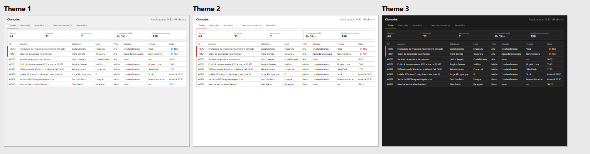

# Crewcraft

*Português: [README.pt-BR.md](README.pt-BR.md)*

**A Claude Code plugin that asks before it builds, shows you the look before it codes, and talks to you at your own level. A crew of specialist roles is planned.**

> Status: early (v0.1.0). Four skills and one command work today. Roles, delivery gates and project research are planned and are **not** in this version.

## Why

Ask an AI for "a calculator" and you get *its* idea of a calculator. You correct it, it rebuilds, you get frustrated. Crewcraft turns that around: before anything is built, it finds out what *you* mean, shows you the options you did not know existed, and lets you approve how it looks.


## What is in 0.1.0

| Piece | What it does |
|---|---|
| `conversa` | Talks first. One question at a time, shows the kinds of thing that exist, records every decision as yours or as a suggestion, and builds nothing until the choices are settled. |
| `ficha-do-projeto` | Keeps everything about a project inside that project, in a `.crewcraft/` folder: decisions, open questions, visual profile. Never overwrites what you edited. |
| `prototipo-visual` | Shows the look in two separate rounds, structure first, then theme and colors, and blocks building until you approve. |
| `gerente` | The manager: turns your decisions into tasks, keeps a queue with priorities (Urgent stops everything), allows one task per role at a time, and reports honestly: only work that is done and tested counts toward the percentage. |
| `/crewcraft:comecar` | Command that starts the conversation: `/crewcraft:comecar I want a dashboard for my team` |

Claude usually starts the conversation by itself when you ask for something to be built, but that is not guaranteed. `/crewcraft:comecar` always starts it.

Skill names are Portuguese (`conversa` = conversation, `ficha-do-projeto` = project file, `prototipo-visual` = visual prototype). Claude answers in **your** language.

### Structure first, then theme

Three layouts that differ in structure, with no colors in them:


Then the same structure under three really different themes. Only the theme file changes:



If you say "it looks like AI made it", Crewcraft changes direction instead of nudging the same palette, asks for a reference, and adds what you disliked to a banned list in your project's visual profile.

## It adapts to you

Your level is kept per area (development, design, security, infrastructure, AI) as `novice`, `intermediate` or `expert`. A beginner gets plain words and analogies. An expert gets short answers and real trade-offs. Say "speak simpler" or "you can be technical" at any time. A technical word alone never makes Crewcraft treat you as an expert: it asks first.

## Install

In Claude Code:

```
/plugin marketplace add <owner>/crewcraft
/plugin install crewcraft@crewcraft
```

Replace `<owner>` with the GitHub account that hosts this repository. Python 3 is optional: it is only used by a small helper that creates the `.crewcraft/` folder, and Crewcraft copies the files by hand if Python is missing.

## Privacy

Crewcraft adds no network calls of its own. Everything about your project stays in your project's `.crewcraft/` folder, and your level profile stays on your computer, never inside the plugin. The helper script and the skills do not write inside any folder named "Não mexer" ("do not touch"), and they ask which folder is the project before creating `.crewcraft/`.

## Planned, not included yet

A manager that plans and orders the work; developer, designer, QA and security roles with one task each at a time; supervisors that block delivery until it is tested; project research (competitors, tools, current documentation) that ends in a short report for you to approve.

## License

To be added before the first release.
