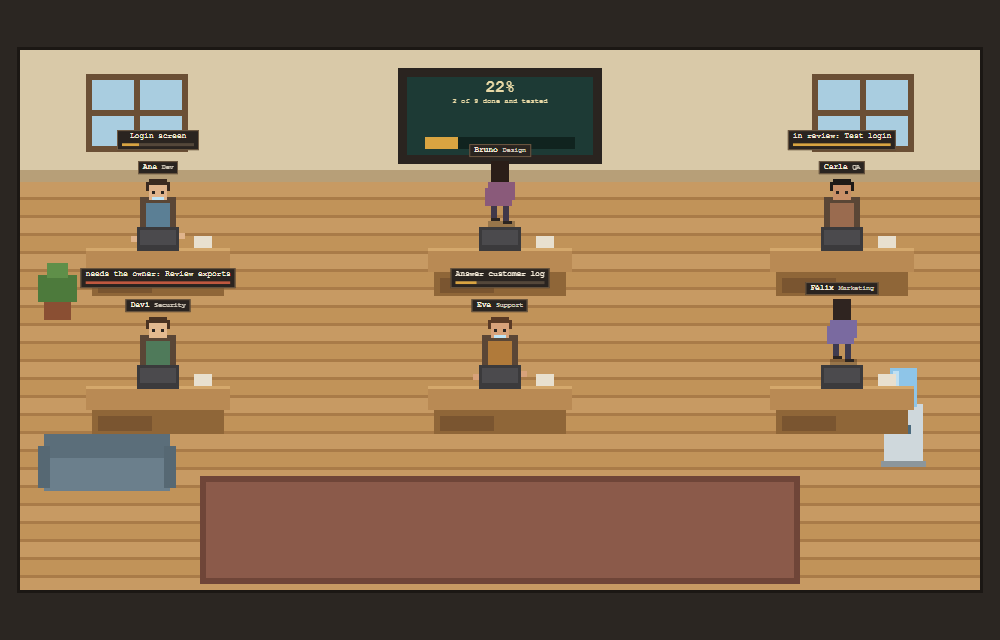
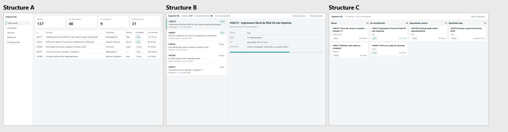

# Crewcraft

[English](#english) · [Português](#português)

---

## English

**A Claude Code plugin that asks before it builds, shows you the look before it codes, and talks to you at your own level. A crew of specialist roles is planned.**

> Status: v1.0.0. Eight skills, three commands, a crew of ten agents, a release gate and an optional pixel office.

### Why

Ask an AI for "a calculator" and you get *its* idea of a calculator. You correct it, it rebuilds, you get frustrated. Crewcraft turns that around: before anything is built, it finds out what *you* mean, shows you the options you did not know existed, and lets you approve how it looks.


### What it recommends

For each project, the research recommends **plugins, skills and MCP servers to install for that project**, each with a verdict (use, improve or avoid), the reason, the source, the date and the license. Crewcraft itself ships none of them: nothing third-party is bundled in this repository. On your computer, what you approve is downloaded and set up for that project only, after it tells you the filename, the source and the size. Anything found online is read and analysed first, never run blindly.

### What is inside

| Piece | What it does |
|---|---|
| `conversa` | Talks first. One question at a time, shows the kinds of thing that exist, records every decision as yours or as a suggestion, and builds nothing until the choices are settled. |
| `ficha-do-projeto` | Keeps everything about a project inside that project, in a `.crewcraft/` folder: decisions, open questions, visual profile. Never overwrites what you edited. |
| `prototipo-visual` | Shows the look in two separate rounds, structure first, then theme and colors, and blocks building until you approve. |
| `gerente` | The manager: turns your decisions into tasks, keeps a queue with priorities (Urgent stops everything), allows one task per role at a time, and reports honestly: only work that is done and tested counts toward the percentage. |
| `pesquisa` | Looks outside before the look is shown or the work is planned: competitors and how they are built, tools and skills that could help, current documentation, and a verdict (use, improve, avoid) on what you already have installed. Searches are generic and logged, every row has a source and a date, and you approve the report first. |
| `enxuto` | The lean rule: the least that fully does the job. Standard library first, nothing nobody asked for, never less safe, and every delivery says what was left out. Includes an audit of dependencies that are declared but never used. |
| `skills-do-projeto` | After the research is approved, writes a few small skills inside the project (aligned with its decisions, sourced and dated) and a managed block in its `CLAUDE.md`, instead of keeping general skills installed. |
| `ambiente` | Finds what is installed on this computer and, for each job (testing in a clean environment, browser checks, version control), lists the options in order with each one's weakness in plain words. Installs nothing without approval. |
| `/crewcraft:escritorio` | Optional pixel office (off unless you start it): each role at a desk, the task above the head of whoever works, idle roles walk, drink water and chat. Read-only and local. |
| `/crewcraft:atualizar` | Refreshes the project's research: re-checks rows older than 18 months and updates the project skills. |
| `/crewcraft:comecar` | Command that starts the conversation: `/crewcraft:comecar I want a dashboard for my team` |

Claude usually starts the conversation by itself when you ask for something to be built, but that is not guaranteed. `/crewcraft:comecar` always starts it.

Skill names are Portuguese (`conversa` = conversation, `ficha-do-projeto` = project file, `prototipo-visual` = visual prototype). Claude answers in **your** language.

### The crew and the release gate

The order is: conversation, **research**, the look, the plan, the work, the release. Research comes before the look because a mockup made without seeing the competitors is a guess.

Each role is a separate agent with its own instructions: `researcher`, `dev`, `design`, `qa`, `security`, `support`, `marketing`, and the supervisors `supervisor-dev`, `supervisor-design` and `supervisor-teste`. Supervisors cannot edit anything: they only run the checks themselves and approve or reject. Each role holds one task at a time, and only work that a supervisor approved counts as done. The third rejection of the same task goes to you.

A hook blocks release commands (`git push`, `npm publish`, deploys) in a project with a Crewcraft queue until every Dev, Design, QA and Security task is approved and you recorded your final test. The hook needs Python on the PATH; without Python it lets everything through, so it never traps you.

#### The office



The office is optional: run `/crewcraft:escritorio` in a project that has a queue and open the address it prints. It is read-only and runs only on your computer.

#### Structure first, then theme

Three layouts that differ in structure, with no colors in them:



Then the same structure under three really different themes. Only the theme file changes:


If you say "it looks like AI made it", Crewcraft changes direction instead of nudging the same palette, asks for a reference, and adds what you disliked to a banned list in your project's visual profile.

### It adapts to you

Your level is kept per area (development, design, security, infrastructure, AI) as `novice`, `intermediate` or `expert`. A beginner gets plain words and analogies. An expert gets short answers and real trade-offs. Say "speak simpler" or "you can be technical" at any time. A technical word alone never makes Crewcraft treat you as an expert: it asks first.

### Install

In Claude Code:

```
/plugin marketplace add fsorato/crewcraft
/plugin install crewcraft@crewcraft
```

Python 3 is optional: it is only used by a small helper that creates the `.crewcraft/` folder, and Crewcraft copies the files by hand if Python is missing.

### Privacy

Crewcraft adds no network calls of its own. Everything about your project stays in your project's `.crewcraft/` folder, and your level profile stays on your computer, never inside the plugin. The helper script and the skills do not write inside any folder named "Não mexer" ("do not touch"), and they ask which folder is the project before creating `.crewcraft/`. Searches never carry client, project or personal data, and every one is logged in `.crewcraft/buscas.md`. Skills found online are only read and analysed, never run; for a stronger check we recommend NVIDIA's open-source scanner SkillSpector (official repository: github.com/NVIDIA/SkillSpector) using its local scan. Customer logs are masked (ids, e-mails, passwords, addresses) before the support role reads them, and the optional office page listens on 127.0.0.1 only.

### Planned, not included yet

An optional local background engine that serves code navigation, search and documentation lookups from a single process.

### License

MIT. See the `LICENSE` file.

---

## Português

**Um plugin do Claude Code que pergunta antes de construir, mostra o visual antes de programar e conversa no seu nível. Uma equipe de cargos especialistas está planejada.**

> Estado: v1.0.0. Oito skills, três comandos, uma equipe de dez agentes, um portão de liberação e um escritório pixel opcional.

### Por quê

Peça "uma calculadora" a uma IA e você recebe a ideia **dela** de calculadora. Você corrige, ela refaz, e você se frustra. O Crewcraft inverte isso: antes de construir, ele descobre o que **você** quer dizer, mostra as opções que você não sabia que existiam e deixa você aprovar o visual.


### O que ele recomenda

Para cada projeto, a pesquisa recomenda **plugins, skills e servidores MCP para instalar naquele projeto**, cada um com um veredito (usar, melhorar ou evitar), o motivo, a fonte, a data e a licença. O próprio Crewcraft não traz nenhum deles: nada de terceiros vem junto neste repositório. No seu computador, o que você aprovar é baixado e configurado só para aquele projeto, depois de ele dizer o nome do arquivo, a origem e o tamanho. Tudo que vem da internet é lido e analisado antes, nunca executado às cegas.

### O que tem dentro

| Peça | O que faz |
|---|---|
| `conversa` | Conversa primeiro. Uma pergunta por vez, mostra os tipos que existem, grava cada decisão como sua ou como sugestão, e não constrói nada até as escolhas estarem fechadas. |
| `ficha-do-projeto` | Guarda tudo de um projeto dentro dele, numa pasta `.crewcraft/`: decisões, perguntas em aberto, perfil visual. Nunca sobrescreve o que você editou. |
| `prototipo-visual` | Mostra o visual em duas rodadas separadas, primeiro a estrutura, depois tema e cores, e bloqueia a construção até você aprovar. |
| `gerente` | O gerente: transforma suas decisões em tarefas, mantém uma fila com prioridades (Urgente para tudo), permite uma tarefa por cargo de cada vez e informa com honestidade: só o que está pronto e testado conta na porcentagem. |
| `pesquisa` | Olha para fora antes de mostrar o visual ou planejar o trabalho: concorrentes e como são feitos, ferramentas e skills que podem ajudar, documentação atual, e um veredito (usar, melhorar, evitar) sobre o que você já tem instalado. As buscas são genéricas e ficam registradas, toda linha tem fonte e data, e você aprova o relatório primeiro. |
| `enxuto` | A regra enxuta: o mínimo que faz o trabalho por completo. Biblioteca padrão primeiro, nada que ninguém pediu, nunca menos seguro, e toda entrega diz o que ficou de fora. Inclui uma auditoria de dependências declaradas e nunca usadas. |
| `skills-do-projeto` | Depois da pesquisa aprovada, escreve algumas skills pequenas dentro do projeto (alinhadas às decisões, com fonte e data) e um bloco gerenciado no `CLAUDE.md` dele, em vez de manter skills gerais instaladas. |
| `ambiente` | Descobre o que está instalado neste computador e, para cada função (teste em ambiente limpo, checagem no navegador, controle de versão), lista as opções em ordem com a fraqueza de cada uma em palavras simples. Não instala nada sem aprovação. |
| `/crewcraft:escritorio` | Escritório pixel opcional (desligado até você iniciar): cada cargo na sua mesa, a tarefa em cima da cabeça de quem trabalha, e quem está parado passeia, bebe água e conversa. Só lê e é local. |
| `/crewcraft:atualizar` | Atualiza a pesquisa do projeto: reconfere linhas com mais de 18 meses e atualiza as skills do projeto. |
| `/crewcraft:comecar` | Comando que inicia a conversa: `/crewcraft:comecar quero um painel para minha equipe` |

O Claude costuma iniciar a conversa sozinho quando você pede para construir algo, mas isso não é garantido. `/crewcraft:comecar` sempre inicia.

Os nomes das skills estão em português. O Claude responde no **seu** idioma.

### A equipe e o portão de liberação

A ordem é: conversa, **pesquisa**, o visual, o plano, o trabalho, a liberação. A pesquisa vem antes do visual porque um protótipo feito sem olhar os concorrentes é um palpite.

Cada cargo é um agente separado, com instruções próprias: `researcher`, `dev`, `design`, `qa`, `security`, `support`, `marketing`, e os supervisores `supervisor-dev`, `supervisor-design` e `supervisor-teste`. Os supervisores não podem editar nada: só rodam as conferências eles mesmos e aprovam ou reprovam. Cada cargo faz uma tarefa por vez, e só o que um supervisor aprovou conta como pronto. A terceira reprovação da mesma tarefa chega até você.

Um gancho bloqueia comandos de liberação (`git push`, `npm publish`, deploys) num projeto com fila do Crewcraft até que toda tarefa de Dev, Design, QA e Segurança esteja aprovada e você tenha registrado o seu teste final. O gancho precisa de Python no PATH; sem Python ele deixa tudo passar, para nunca te prender.

#### O escritório


O escritório é opcional: rode `/crewcraft:escritorio` num projeto que tenha fila e abra o endereço que ele mostrar. Só lê e roda apenas no seu computador.

#### Primeiro a estrutura, depois o tema

Três layouts que diferem na estrutura, sem nenhuma cor escrita neles:


Depois, a mesma estrutura com três temas bem diferentes. Só o arquivo de tema muda:


Se você disser "parece feito por IA", o Crewcraft muda de direção em vez de ajustar a mesma paleta, pede uma referência e anota o que você não gostou numa lista de proibidos do perfil visual do projeto.

### Ele se adapta a você

Seu nível é guardado por área (desenvolvimento, design, segurança, infraestrutura, IA) como `novice` (iniciante), `intermediate` (intermediário) ou `expert` (especialista). Iniciante recebe palavras simples e analogias. Especialista recebe respostas curtas e os prós e contras técnicos. Diga "fale mais simples" ou "pode ser técnico" quando quiser. Um termo técnico solto nunca faz o Crewcraft tratar você como especialista: ele pergunta antes.

### Instalação

No Claude Code:

```
/plugin marketplace add fsorato/crewcraft
/plugin install crewcraft@crewcraft
```

Python 3 é opcional: serve só para um pequeno auxiliar que cria a pasta `.crewcraft/`, e o Crewcraft copia os arquivos à mão se não houver Python.

### Privacidade

O Crewcraft não faz nenhuma chamada de rede por conta própria. Tudo do seu projeto fica na pasta `.crewcraft/` dele, e o seu perfil de nível fica no seu computador, nunca dentro do plugin. O auxiliar e as skills não gravam dentro de nenhuma pasta chamada "Não mexer", e perguntam qual pasta é o projeto antes de criar a `.crewcraft/`. As buscas nunca levam dados de cliente, do projeto ou pessoais, e cada uma fica registrada em `.crewcraft/buscas.md`. Skills encontradas na internet são só lidas e analisadas, nunca executadas; para uma checagem mais forte recomendamos o scanner de código aberto da NVIDIA, o SkillSpector (repositório oficial: github.com/NVIDIA/SkillSpector), usando a varredura local. Os logs de clientes são mascarados (documentos, e-mails, senhas, endereços) antes de o cargo de suporte lê-los, e a página opcional do escritório escuta só em 127.0.0.1.

### Planejado, ainda não incluído

Um motor local opcional em segundo plano que serve navegação de código, busca e consulta de documentação a partir de um único processo.

### Licença

MIT. Veja o arquivo `LICENSE`.
