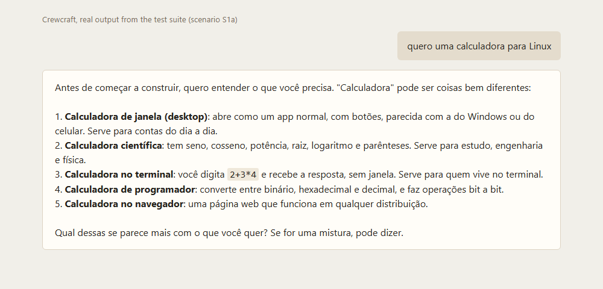
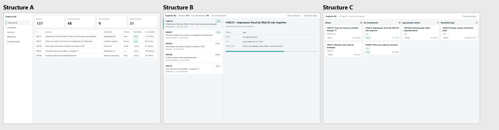
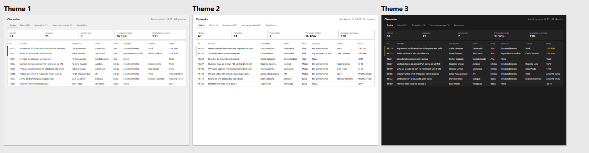

# Crewcraft

*English: [README.md](README.md)*

**Um plugin do Claude Code que pergunta antes de construir, mostra o visual antes de programar e conversa no seu nível. Uma equipe de cargos especialistas está planejada.**

> Estado: inicial (v0.1.0). Três skills e um comando funcionam hoje. Cargos, portões de entrega e pesquisa do projeto estão planejados e **não** fazem parte desta versão.

## Por quê

Peça "uma calculadora" a uma IA e você recebe a ideia **dela** de calculadora. Você corrige, ela refaz, e você se frustra. O Crewcraft inverte isso: antes de construir, ele descobre o que **você** quer dizer, mostra as opções que você não sabia que existiam e deixa você aprovar o visual.



## O que tem na 0.1.0

| Peça | O que faz |
|---|---|
| `conversa` | Conversa primeiro. Uma pergunta por vez, mostra os tipos que existem, grava cada decisão como sua ou como sugestão, e não constrói nada até as escolhas estarem fechadas. |
| `ficha-do-projeto` | Guarda tudo de um projeto dentro dele, numa pasta `.crewcraft/`: decisões, perguntas em aberto, perfil visual. Nunca sobrescreve o que você editou. |
| `prototipo-visual` | Mostra o visual em duas rodadas separadas, primeiro a estrutura, depois tema e cores, e bloqueia a construção até você aprovar. |
| `/crewcraft:comecar` | Comando que inicia a conversa: `/crewcraft:comecar quero um painel para minha equipe` |

O Claude costuma iniciar a conversa sozinho quando você pede para construir algo, mas isso não é garantido. `/crewcraft:comecar` sempre inicia.

Os nomes das skills estão em português. O Claude responde no **seu** idioma.

### Primeiro a estrutura, depois o tema

Três layouts que diferem na estrutura, sem nenhuma cor escrita neles:



Depois, a mesma estrutura com três temas bem diferentes. Só o arquivo de tema muda:



Se você disser "parece feito por IA", o Crewcraft muda de direção em vez de ajustar a mesma paleta, pede uma referência e anota o que você não gostou numa lista de proibidos do perfil visual do projeto.

## Ele se adapta a você

Seu nível é guardado por área (desenvolvimento, design, segurança, infraestrutura, IA) como `novice` (iniciante), `intermediate` (intermediário) ou `expert` (especialista). Iniciante recebe palavras simples e analogias. Especialista recebe respostas curtas e os prós e contras técnicos. Diga "fale mais simples" ou "pode ser técnico" quando quiser. Um termo técnico solto nunca faz o Crewcraft tratar você como especialista: ele pergunta antes.

## Instalação

No Claude Code:

```
/plugin marketplace add <owner>/crewcraft
/plugin install crewcraft@crewcraft
```

Troque `<owner>` pela conta do GitHub que hospeda este repositório. Python 3 é opcional: serve só para um pequeno auxiliar que cria a pasta `.crewcraft/`, e o Crewcraft copia os arquivos à mão se não houver Python.

## Privacidade

O Crewcraft não faz nenhuma chamada de rede por conta própria. Tudo do seu projeto fica na pasta `.crewcraft/` dele, e o seu perfil de nível fica no seu computador, nunca dentro do plugin. O auxiliar e as skills não gravam dentro de nenhuma pasta chamada "Não mexer", e perguntam qual pasta é o projeto antes de criar a `.crewcraft/`.

## Planejado, ainda não incluído

Um gerente que planeja e ordena o trabalho; cargos de desenvolvimento, design, teste e segurança com uma tarefa de cada vez; supervisores que bloqueiam a entrega até ser testada; e pesquisa do projeto (concorrentes, ferramentas, documentação atual) que termina num relatório curto para você aprovar.

## Licença

A definir antes da primeira versão pública.
